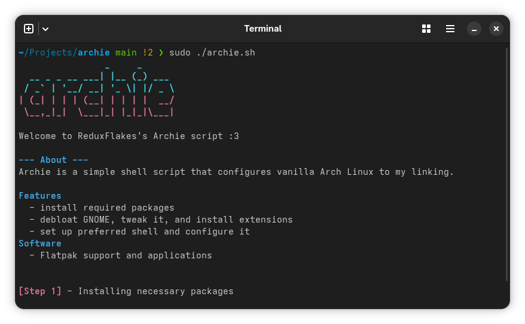

# archie

My Arch Linux setup script

## Features

- Install essential packages, like text editor, utilities, git, and more
- Setup GNOME by removing unused apps, change gsettings, and install some extensions
- Install and configure ZSH
- Install my required software (including Flatpak applications)

## Roadmap

This is a work in progress script, a lot of my setup is still not covered by archie but I'm slowly working on it to implement everything I need.

**Planned stuff**

- [Performance tweaks](https://github.com/ReduxFlakes/redux-arch-settings)
- Setup btrfs snapshots with hooks
- Add my custom Tuned profiles
- Install pro audio packages
